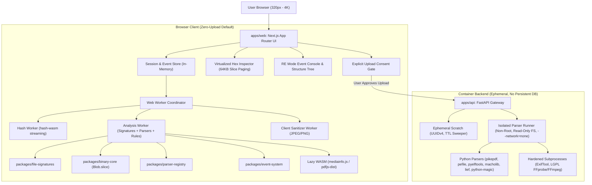
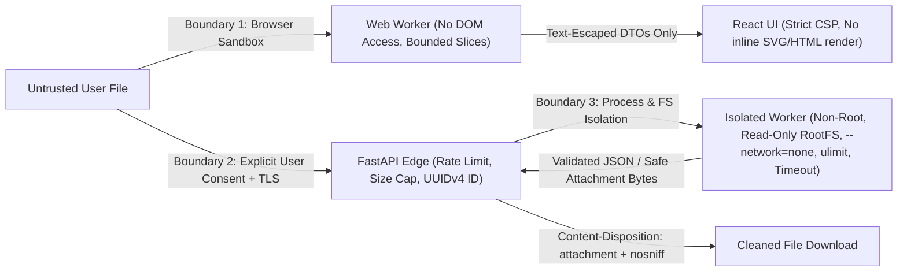

# TRACE — System Architecture

**Phase:** 2 — System Architecture  
**Status:** Proposed for Review

---

## 1. Architectural Principles

1. **Local-First Execution:** File bytes stay inside the user's browser by default. Identification, streaming SHA-256, range-based hex paging, and core parsers run inside isolated Web Workers.
2. **Explicit Consent Boundary:** No file leaves the browser automatically. Escalating to the backend for deep parsing (`ExifTool`, `FFprobe`, `pikepdf`/`qpdf`, binary executable analysis) requires explicit user confirmation.
3. **Minimal Justified Infrastructure:** No user database, no persistent object store, and no message broker in P0/P1. Backend jobs use ephemeral container-local temp storage (`tmpfs` / bounded scratch volume) with deterministic cleanup and Server-Sent Events (SSE) for real-time progress. Redis is deferred until horizontal multi-worker queueing is actually required (P2+).
4. **Shared Core Packages:** Signature definitions, normalized metadata schemas, typed `RE Mode` events, and report schemas live in shared workspace packages so frontend workers, UI, and tests stay strictly typed and consistent.
5. **Dual-Mode Single Engine:** `Analysis Mode` and `RE Mode` read from the exact same session store and typed event log—never duplicate analysis engines.

---

## 2. Monorepo & Component Architecture

```text
trace/
├── apps/
│   ├── web/        # Next.js (App Router) + React + TypeScript + Tailwind + Web Workers
│   └── api/        # Python FastAPI + Isolated Parser/Sanitizer Subprocess Workers
├── packages/
│   ├── shared-types/     # Canonical TypeScript interfaces (FileSession, MetadataField, Finding, Coverage)
│   ├── file-signatures/  # Magic-number registry, multi-offset matchers, container refinement
│   ├── binary-core/      # RangeReader, SliceReader, endian-safe DataView cursor
│   ├── parser-registry/  # Format Support Registry & parser selection planner
│   ├── event-system/     # Typed RE Mode event definitions & ring-buffer emitter
│   └── report-schema/    # Versioned JSON/CSV/PDF report schema & validators
├── test-fixtures/        # Valid, renamed, truncated, malformed, and sparse large fixtures
└── docs/                 # Architecture, requirements, security, and design documentation
```

### Component Diagram



---

## 3. Technology Decisions & Justifications

### 3.1 Frontend (`apps/web`)
| Decision | Choice | Justification |
| :--- | :--- | :--- |
| **Framework** | **Next.js (App Router) + React + TypeScript** | Static/SSR marketing & documentation pages (`/` landing, `/formats`, `/guides`, `/privacy`, `/security`) load fast with tiny JS payloads; `/workspace` lazy-loads heavy inspection components and Web Workers cleanly. |
| **Styling** | **Tailwind CSS + custom restrained primitives** | Predictable design tokens (`graphite`, `charcoal`, `terminal-green`, `amber`, `red`), fluid responsive breakpoints up to 4K/TV, zero bloat from heavy UI kits. |
| **State Management** | **In-Memory Store (Zustand) + URL-free session isolation** | Keeps sensitive file metadata and event streams strictly in volatile tab memory (`IndexedDB` is **not** used by default so nothing persists on disk unexpectedly). |
| **Web Workers** | **Dedicated Workers (`HashWorker`, `AnalysisWorker`)** | Cloning the `File` handle to a worker lets the worker call `file.slice()` off the main thread. Transferable `ArrayBuffer`s (`[buffer]`) pass small hex windows without copying. |
| **WebAssembly** | **`hash-wasm` + lazy `mediainfo.js`** | `hash-wasm` streams 5 GB SHA-256 at native-like speed with ~32 MB chunks; `mediainfo.js` (~2 MB WASM) is dynamically imported **only** when inspecting audio/video formats, keeping landing-page bundle `< 120 KB`. |
| **COOP / COEP** | **Not required for MVP** | Avoids `SharedArrayBuffer` requirement so standard hosting, embeds, and Safari work reliably without cross-origin isolation breakage. |

### 3.2 Backend (`apps/api`)
| Decision | Choice | Justification |
| :--- | :--- | :--- |
| **API Framework** | **Python + FastAPI** | Native ecosystem for forensic/binary tools (`pikepdf`/`qpdf`, `pefile`, `pyelftools`, `macholib`, `lief`, `python-magic`), strict Pydantic validation, and native `StreamingResponse` for SSE event streaming. |
| **Processing Model** | **Bounded Synchronous / SSE Job Execution (No Redis in P0/P1)** | Single-request streaming upload -> ephemeral scratch -> isolated parser subprocess -> SSE event stream -> immediate `finally` cleanup removes operational complexity. Redis + Celery/ARQ will only be added in P2 if long-running multi-GB backend jobs require async background queues. |
| **Subprocess Isolation** | **Non-root container + `subprocess.run(..., shell=False)` + `ulimit` + timeouts** | Keeps `ExifTool` (Artistic/GPL) and `FFprobe` (LGPL build) strictly at a process boundary, prevents command injection, and caps CPU/RAM/wall-clock execution on malformed files. |
| **Deployment Topology** | **Vercel (`apps/web`) + Dedicated Container Host (`apps/api`)** | Serverless frontend handlers have short timeouts (10–60s) and tiny body limits (4.5 MB on Vercel), making them unsuitable for file analysis. Separating `apps/api` onto container hosting (Fly.io / Cloud Run / VPS Docker) gives full control over timeouts, `tmpfs`, and `qpdf`/`ExifTool` binaries. |

---

## 4. Security Boundary Diagram



### Key Boundary Rules
1. **Browser Worker <-> React UI:** Workers never touch the DOM; React renders all extracted metadata as plain text (never `dangerouslySetInnerHTML`) and never loads uploaded SVG/PDF/HTML as active origins.
2. **Client <-> Backend API:** Zero automatic uploads. Crosses only on explicit user action. Separate download headers (`Content-Disposition: attachment`, `X-Content-Type-Options: nosniff`, `Cache-Control: no-store`).
3. **API Gateway <-> Parser Sandbox:** Filenames are replaced by UUIDv4 on ingestion; `shell=False` always; outbound network disabled (`--network=none`) inside parser containers to block SSRF/exfiltration; XML external entities disabled.

---

## 5. Temporary File Lifecycle & Storage Model

- **Client-Side (Default):** Zero persistent disk storage. Closing or clearing the file drops all references in volatile memory and terminates active Web Workers.
- **Backend (Consented Operations Only):**
  1. Upload streams directly to `/tmp/trace-jobs/<uuid>/input.bin` (never using the original filename).
  2. Size cap & timeout enforced during upload and parsing.
  3. Cleaned output (if sanitization requested) written to `/tmp/trace-jobs/<uuid>/output.bin`.
  4. Immediately after response streaming or download completion (and inside `try/finally` on crashes/timeouts), `/tmp/trace-jobs/<uuid>/` is deleted.
  5. A background sweeper thread runs every 60 seconds to delete any orphaned directory older than `TTL = 10 minutes`.
  6. **Honest Storage Note:** Deletion performs OS `unlink()`. Physical block erasure on cloud SSDs is governed by infrastructure encryption-at-rest and underlying cloud storage semantics, documented transparently in `08-privacy-policy-requirements.md`.

---

## 6. API Surface Overview (Consented Operations Only)

| Endpoint | Method | Purpose | Priority |
| :--- | :--- | :--- | :--- |
| `/api/v1/health` | `GET` | Liveness + available backend parser versions (`exiftool`, `qpdf`, `ffprobe`) | P0/P1 |
| `/api/v1/analyze` | `POST` | Consented deep analysis returning JSON or SSE stream of typed events + normalized result | P1 |
| `/api/v1/sanitize` | `POST` | Format-specific server sanitization (e.g., `pikepdf` PDF scrubbing) returning job token + verification report | P1 |
| `/api/v1/jobs/{job_id}/download` | `GET` | One-time safe attachment download (`nosniff`, `no-store`) followed by immediate deletion | P1 |
