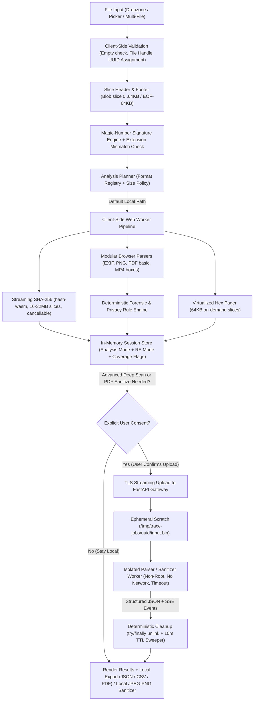

# TRACE — Data Flow & Byte Residency Specification

**Phase:** 2 — Data Flow Architecture  
**Purpose:** Trace every hop where file bytes, extracted metadata, cryptographic hashes, or personal information can exist—both client-side and during optional consented backend processing.

---

## 1. End-to-End Data Flow Diagram



---

## 2. Processing Sequence Diagram (`Analysis Mode` & `RE Mode` Unified Flow)

```mermaid
sequenceDiagram
    autonumber
    actor User
    participant UI as Workspace UI (Analysis / RE Mode)
    participant Coord as Worker Coordinator
    participant AW as AnalysisWorker
    participant HW as HashWorker

    User->>UI: Drops file (e.g., 5 GB video or JPEG)
    UI->>Coord: enqueueFile(File handle, uuid)
    Coord-->>UI: Event: FILE_RECEIVED (no raw bytes logged)
    Coord->>AW: postMessage({ file, fileId })
    Coord->>HW: postMessage({ file, fileId }) [if auto-hash or requested]

    AW-->>UI: Event: FILE_VALIDATION_STARTED
    AW->>AW: file.slice(0, 65536).arrayBuffer()
    AW-->>UI: Event: HEADER_READ (offset=0x0, length=65536)
    AW-->>UI: Event: SIGNATURE_MATCHED (or SIGNATURE_MISMATCH)
    AW-->>UI: Event: MIME_IDENTIFIED + PARSER_SELECTED
    AW-->>UI: Event: PARSER_STARTED
    AW->>AW: Seek & parse metadata / boxes via bounded Blob.slice()
    AW-->>UI: Event: STRUCTURE_DETECTED + METADATA_FIELD_FOUND (with exact byteRange if known)
    AW-->>UI: Event: SENSITIVE_FIELD_FOUND / ANOMALY_DETECTED
    AW-->>UI: Event: ANALYSIS_COMPLETED (with Coverage flags)

    loop Streaming 16-32MB Chunks
        HW->>HW: file.slice(offset, offset+chunk).arrayBuffer()
        HW->>HW: hasher.update(chunk)
        HW-->>UI: Event: HASHING_PROGRESS (percent, bytesProcessed)
    end
    HW-->>UI: Event: HASHING_COMPLETED (sha256)

    User->>UI: Toggles Analysis Mode <-> RE Mode
    Note over UI: Zero re-parsing; both views read identical session state & event stream
    User->>UI: Clicks metadata field with byteRange
    UI->>AW: readHexWindow(startOffset, 4096)
    AW-->>UI: Transferable ArrayBuffer [4KB] -> Hex Inspector scrolls & highlights range
```

---

## 3. Data Residency & Privacy Inventory

Every location where file data, metadata, hashes, or PII may transiently exist:

| Data Asset | Location (Local Mode) | Location (Consented Backend Mode) | Retention & Clearance | Logging Policy |
| :--- | :--- | :--- | :--- | :--- |
| **Raw File Bytes** | User's local disk; only active `Blob.slice()` windows (4 KB–32 MB) enter Worker RAM briefly before GC. | Ephemeral `/tmp/trace-jobs/<uuid>/input.bin` inside backend container + worker process RAM. | **Local:** Released immediately when chunk finishes or worker terminates. **Backend:** `unlink()` on job completion/error + 10-min TTL sweeper. | **NEVER** logged to console, server logs, or analytics. |
| **Extracted Metadata & PII** (GPS, Author, Serials, Emails) | Volatile React/Zustand store in browser tab memory. | Serialized JSON response in backend RAM -> returned over TLS -> held in browser tab memory. | Cleared on file removal, browser refresh, or tab close. Not stored in `localStorage` or `IndexedDB` by default. | **NEVER** written to backend application logs or third-party telemetry. |
| **Cryptographic Hashes (SHA-256)** | Browser tab memory + user-triggered export files (JSON/CSV/PDF). | Returned in response payload; optionally omitted from server logs. | Volatile tab memory; user controls any exported report files. | Safe to log internally only if anonymized/correlated without PII, or omitted entirely by default. |
| **RE Mode Event Stream** | Browser in-memory ring buffer (`max 5,000 events` per file) with sanitized payload summaries. | Streamed over SSE (`POST /analyze`) without sensitive field values in plain diagnostic strings. | Cleared when file session closes; user-triggered `Export Log` stays local. | Events record offsets, parser IDs, and counts—sensitive field values are masked or kept out of diagnostic strings. |
| **Sanitized Output File** | Generated as `Blob` in browser RAM (`<name>.clean.<ext>`) and saved via browser download. | Written briefly to `/tmp/trace-jobs/<uuid>/output.bin`, streamed via one-time download URL, then immediately unlinked. | Browser revokes `URL.createObjectURL()` immediately after download trigger; backend deletes after transfer or 10-min TTL. | Never served inline; `Cache-Control: no-store`. |
| **Contact / Format Request Form** | Optional form fields submitted over HTTPS only if user explicitly submits `/contact`. | Forwarded to support inbox / issue queue; zero file bytes attached. | Standard support retention only for submitted form text. | Explicitly separated from file analysis workspace. |
