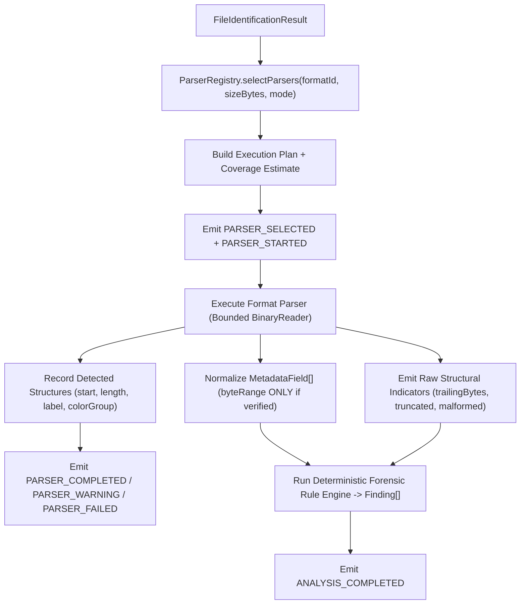

# TRACE — Parser, Binary Engine & Event System Design

**Phase:** 2 — Parser Abstraction & Schemas  
**Scope:** Shared interfaces across `packages/binary-core`, `packages/file-signatures`, `packages/parser-registry`, `packages/shared-types`, and `packages/event-system`.

---

## 1. Range-Based Binary Reading Abstraction (`packages/binary-core`)

To support 5 GB+ files in browser workers and bounded files in Python/Node tests identically, every signature detector and parser reads through an asynchronous **`BinaryReader`** interface rather than expecting a full `Uint8Array`.

```typescript
export interface ByteRange {
  start: number;   // 0-based inclusive byte offset
  length: number;  // byte count (>= 0)
}

export interface BinaryReader {
  readonly byteLength: number;
  read(offset: number, length: number, signal?: AbortSignal): Promise<Uint8Array>;
  sliceReader(offset: number, length: number): BinaryReader; // bounded sub-view without copying whole parent
}
```

### Implementations
- **`BlobBinaryReader` (Browser Worker):** Wraps `File` / `Blob`. Uses `file.slice(offset, offset + clampedLength).arrayBuffer()`, tracks total bytes read for coverage telemetry, enforces single-read max cap (e.g. `16 MB`), and honors `AbortSignal`.
- **`BufferBinaryReader` (Unit Tests / Small Buffers):** Wraps `Uint8Array` cleanly for deterministic golden fixture testing.
- **`BinaryCursor` Helper:** Endian-aware (`big`/`little`) reader built over bounded slices (`readU8`, `readU16`, `readU32`, `readU64`, `readAscii`, `readFourCC`) with automatic bounds checking that throws typed `TruncatedReadError` instead of returning garbage or out-of-range reads.

---

## 2. Magic-Number Signature Engine (`packages/file-signatures`)

Signature rules are declarative and evaluated in two stages:

1. **Primary Byte Matching:** Supports zero-offset signatures (`FF D8 FF`, `89 50 4E 47 0D 0A 1A 0A`, `%PDF-`), non-zero offset signatures (`ftyp` at offset `4`, `ustar` at offset `257`), and variable/masked signatures (`RIFF` at `0` + `WEBP`/`WAVE`/`AVI ` at `8`; `MZ` at `0` + `u32(0x3C)` pointer -> `PE\0\0`).
2. **Container Refinement:** Matches container signatures first (`ZIP`, `ISOBMFF`, `RIFF`, `EBML`), then inspects bounded internal structures (`[Content_Types].xml` -> `DOCX`/`XLSX`/`PPTX`, `ftyp` major brand -> `MP4`/`MOV`/`HEIC`/`AVIF`, EBML `DocType` -> `MKV`/`WebM`).

```typescript
export type IdentificationConfidence = 'confirmed' | 'probable' | 'ambiguous' | 'unknown';

export type FormatSupportStatus =
  | 'fully_supported'
  | 'partially_supported'
  | 'identification_only'
  | 'experimental'
  | 'unsupported';

export interface SignatureEvidence {
  ruleId: string;
  description: string;
  byteRange: ByteRange;
  matchedHex: string;
}

export interface FileIdentificationResult {
  formatId: string;               // e.g. 'jpeg', 'png', 'pdf', 'mp4', 'pe', 'unknown'
  displayName: string;            // e.g. 'JPEG Image'
  category: FormatCategory;       // 'image' | 'audio' | 'video' | 'document' | 'office' | 'archive' | 'executable' | 'other' | 'unknown'
  detectedMime: string;           // e.g. 'image/jpeg'
  declaredExtension: string | null;
  declaredMime: string | null;
  extensionMismatch: boolean;
  confidence: IdentificationConfidence;
  supportStatus: FormatSupportStatus;
  containerFormat?: string;       // e.g. 'zip', 'isobmff', 'riff'
  evidence: SignatureEvidence[];
  secondaryMatches: string[];     // e.g. polyglot or weak matches
}
```

---

## 3. Typed Parser Interface & Execution Flow (`packages/parser-registry`)



### Normalized Metadata Schema (`packages/shared-types`)

Every parser must emit fields matching this canonical structure:

```typescript
export type MetadataGroup =
  | 'general' | 'exif' | 'iptc' | 'xmp' | 'gps' | 'camera'
  | 'audio' | 'video' | 'pdf' | 'office' | 'archive' | 'binary' | 'embedded';

export type FieldStatus = 'valid' | 'missing' | 'malformed' | 'suspicious';

export interface MetadataField {
  id: string;
  fieldName: string;              // Human-readable name, e.g. "GPS Latitude"
  rawKey?: string;                // Spec tag/atom key, e.g. "GPSLatitude" or "mvhd.creation_time"
  value: string | number | boolean | string[] | null;
  displayValue: string;
  dataType: 'string' | 'number' | 'boolean' | 'date' | 'coordinates' | 'bytes' | 'array' | 'object';
  group: MetadataGroup;
  sourceParser: string;           // e.g. 'jpeg-segment-parser', 'exifr-exif-parser'
  byteRange?: ByteRange;          // OMITTED unless parser mathematically established exact offset & length
  confidence: 'confirmed' | 'probable' | 'inferred';
  isSensitive: boolean;
  sensitivityReason?: string;
  status: FieldStatus;
}

export interface DetectedStructure {
  id: string;
  name: string;                   // e.g. "APP1 (EXIF)", "IHDR Chunk", "moov Box"
  type: string;
  byteRange: ByteRange;           // Required for structures mapped in Hex Inspector
  parentId?: string;
  children?: DetectedStructure[];
  summary?: string;
}
```

### Forensic Findings Schema

```typescript
export type FindingSeverity = 'informational' | 'low' | 'medium' | 'high' | 'critical';

export interface ForensicFinding {
  id: string;
  ruleId: string;
  category: 'privacy' | 'integrity' | 'structure' | 'mismatch';
  title: string;
  severity: FindingSeverity;
  explanation: string;
  evidence: string;
  affectedFieldIds: string[];
  byteRange?: ByteRange;
  whyItMatters: string;
  suggestedAction: string;
  detectionMethod: string;
  confidence: 'confirmed' | 'probable';
}
```

### Analysis Coverage Schema

```typescript
export interface AnalysisCoverage {
  mode: 'local_browser' | 'consented_backend';
  headerInspected: boolean;
  footerInspected: boolean;
  containerIndexInspected: boolean;
  completeFileScanned: boolean;
  fullHashComputed: boolean;
  uninspectedReasons: string[];   // e.g. ["Media mdat payload (4.92 GB) not sequentially decoded in local mode"]
}
```

---

## 4. Typed `RE Mode` Event System (`packages/event-system`)

All 22 canonical event types emitted by live workers and streamed to `RE Mode`:

| Phase | Event Types |
| :--- | :--- |
| **Ingestion & ID** | `FILE_RECEIVED`, `FILE_VALIDATION_STARTED`, `HEADER_READ`, `SIGNATURE_MATCHED`, `SIGNATURE_MISMATCH`, `MIME_IDENTIFIED` |
| **Hashing** | `HASHING_STARTED`, `HASHING_PROGRESS`, `HASHING_COMPLETED` |
| **Parsing** | `PARSER_SELECTED`, `PARSER_STARTED`, `STRUCTURE_DETECTED`, `METADATA_GROUP_STARTED`, `METADATA_FIELD_FOUND`, `SENSITIVE_FIELD_FOUND`, `ANOMALY_DETECTED`, `PARSER_WARNING`, `PARSER_FAILED` |
| **Sanitization & Lifecycle** | `SANITIZATION_STARTED`, `SANITIZATION_COMPLETED`, `VERIFICATION_COMPLETED`, `ANALYSIS_COMPLETED` |

```typescript
export type TraceEventSeverity = 'debug' | 'info' | 'warn' | 'error' | 'finding';

export interface TraceEvent {
  id: string;
  sequence: number;
  timestampIso: string;           // High-precision ISO timestamp
  eventType: TraceEventType;
  severity: TraceEventSeverity;
  fileId: string;
  parserId?: string;
  operation: string;              // Concrete operation executed, e.g. "BinaryReader.read(0, 32)"
  message: string;                // Concise human/engineer readable log line (never raw PII values)
  byteRange?: ByteRange;          // Click-to-jump target in Hex Inspector
  payload?: Record<string, string | number | boolean | null>;
}
```

### Safety & Authenticity Rules
1. **No Sensitive Value Leakage in Logs:** `METADATA_FIELD_FOUND` and `SENSITIVE_FIELD_FOUND` log field keys, groups, byte offsets, and sensitivity flags—never raw GPS coordinates, emails, or serial numbers into diagnostic telemetry.
2. **Bounded Buffer:** `RE Mode` retains a ring buffer of up to `5,000` events per file (summarizing high-volume tag loops if needed) so UI memory never balloons.
3. **Read-Only Inspection:** `RE Mode` strictly filters, searches, pauses display, exports logs, and jumps to offsets—it never interprets or executes user input as commands.
